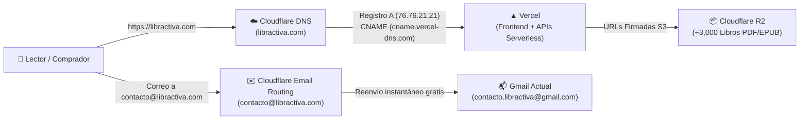

# 🌐 Guía: Configuración de Dominio Propio (`libractiva.com`) con Cloudflare y Vercel

Esta guía documenta paso a paso cómo registrar el dominio oficial **`libractiva.com`** al costo mayorista en **Cloudflare Registrar**, conectarlo al despliegue de **Vercel**, configurar el correo institucional gratuito **`contacto@libractiva.com`** mediante **Cloudflare Email Routing** y actualizar las referencias del código fuente.

---

## 🏗️ Arquitectura de la Solución

Al utilizar la misma cuenta de Cloudflare donde ya reside el bucket **Cloudflare R2** de los libros, toda la infraestructura queda centralizada en dos plataformas sin intermediarios comerciales:



### Resumen de Costos Reales
* **Registro de `libractiva.com` (Año 1):** ~$10.46 USD (≈ **$210 MXN**).
* **Renovación anual (Año 2 en adelante):** ~$10.46 USD (≈ **$210 MXN/año**, precio mayorista Verisign + ICANN sin margen comercial).
* **Privacidad WHOIS / RDAP:** **$0 MXN** (incluida por defecto).
* **Certificado SSL (HTTPS):** **$0 MXN** (emitido y renovado automáticamente por Vercel).
* **Reenvío de correo `@libractiva.com`:** **$0 MXN** (incluido en Cloudflare Email Routing).

---

## 📋 Fase 1: Comprar `libractiva.com` en Cloudflare Registrar

> [!IMPORTANT]
> Utiliza la **misma cuenta de Cloudflare** donde creaste tu bucket de Cloudflare R2 (`biblioteca-digital`) para tener todo unificado en un solo panel.

1. Inicia sesión en [dash.cloudflare.com](https://dash.cloudflare.com).
2. En la barra lateral izquierda, despliega la sección **Domain Registration** (Registro de dominios) y haz clic en **Register Domains** (Registrar dominios).
3. En el buscador central, escribe **`libractiva.com`** y presiona **Search**.
4. Verifica que aparezca como disponible por **~$10.46 USD / year** y haz clic en **Confirm** / **Purchase**.
5. **Configuración del formulario de registro:**
   * **Years (Plazo):** Selecciona **1 year** (1 año). No necesitas atarte a múltiples años; en Cloudflare el precio de renovación no tiene recargos.
   * **Auto-renew (Renovación automática):** Déjalo activado para evitar perder el dominio por olvido.
   * **Registrant Contact Information:** Ingresa tus datos reales (nombre, dirección en México, teléfono y tu correo `contacto.libractiva@gmail.com`).
     * *Nota de privacidad:* Cloudflare activa **WHOIS Redaction** automáticamente, por lo que ninguno de tus datos personales será público en internet.
6. **Método de pago:** Ingresa tu tarjeta de débito/crédito o PayPal y completa el pago.
7. **Verificación obligatoria de ICANN (Crítico):**
   * Abre la bandeja de entrada de tu correo (`contacto.libractiva@gmail.com`).
   * Recibirás un correo de Cloudflare / ICANN con el asunto *"Please verify your email address"* o *"Verifica tu dirección de correo electrónico"*.
   * **Haz clic en el enlace de confirmación dentro del correo.** (Si no se confirma en los primeros 15 días, ICANN suspende temporalmente cualquier dominio nuevo).

---

## ▲ Fase 2: Agregar el Dominio en el Panel de Vercel

Antes de tocar los registros DNS en Cloudflare, registra el dominio en tu proyecto de Vercel para que el servidor sepa qué tráfico debe recibir:

1. Inicia sesión en [vercel.com/dashboard](https://vercel.com/dashboard) y entra a tu proyecto de **Libractiva** (`biblioteca-digital`).
2. En la pestaña superior, haz clic en **Settings** y luego en el menú izquierdo selecciona **Domains**.
3. En el campo de texto, escribe **`libractiva.com`** y presiona el botón **Add**.
4. Aparecerá una ventana modal preguntando cómo deseas configurar las redirecciones. Selecciona la primera opción recomendada:
   * **Add `www.libractiva.com` and redirect it to `libractiva.com` (Recommended)**.
   * Haz clic en **Add**.
5. Vercel mostrará ambos dominios con una alerta temporal de **"Invalid Configuration"** (es normal porque aún no creamos los registros en Cloudflare) y te mostrará los valores exactos de registro `A` y `CNAME`.

---

## 🔗 Fase 3: Configurar los Registros DNS en Cloudflare hacia Vercel

Ahora conectaremos el dominio de Cloudflare con los servidores de Vercel:

1. Regresa a tu panel de [dash.cloudflare.com](https://dash.cloudflare.com).
2. Haz clic en **Websites** (o **Domains**) en el menú izquierdo y selecciona **`libractiva.com`**.
3. En el menú lateral izquierdo del dominio, entra a **DNS** $\rightarrow$ **Records** (Registros).
4. Haz clic en el botón azul **+ Add record** (Agregar registro) y crea los siguientes **2 registros**:

### Registro 1: Dominio Raíz (`libractiva.com`)
| Campo | Valor a ingresar |
| :--- | :--- |
| **Type (Tipo)** | `A` |
| **Name (Nombre)** | `@` |
| **IPv4 address (Dirección IPv4)** | `76.76.21.21` *(o la IP que te indique tu tarjeta de dominio en Vercel)* |
| **Proxy status (Estado del proxy)** | **APAGADO (Nube Gris / DNS Only)** ⚠️ *Muy importante* |
| **TTL** | `Auto` |

Haz clic en **Save** (Guardar).

### Registro 2: Subdominio `www` (`www.libractiva.com`)
Haz clic nuevamente en **+ Add record**:

| Campo | Valor a ingresar |
| :--- | :--- |
| **Type (Tipo)** | `CNAME` |
| **Name (Nombre)** | `www` |
| **Target (Destino)** | `cname.vercel-dns.com` |
| **Proxy status (Estado del proxy)** | **APAGADO (Nube Gris / DNS Only)** ⚠️ *Muy importante* |
| **TTL** | `Auto` |

Haz clic en **Save** (Guardar).

> [!WARNING]
> **¿Por qué el interruptor de Proxy debe estar en "Nube Gris (DNS Only)"?**
> Si dejas la nube naranja activada en Cloudflare al inicio, Cloudflare intercepta el tráfico antes que Vercel y puede provocar un bucle infinito de redirecciones (`ERR_TOO_MANY_REDIRECTS`) o impedir que Vercel renueve automáticamente su certificado SSL de Let's Encrypt. Con la **nube gris (DNS Only)**, Vercel maneja directamente el certificado SSL y su propia red Edge global sin conflictos.

### Verificar la activación en Vercel (2 a 5 minutos)
1. Vuelve a la pestaña **Settings** $\rightarrow$ **Domains** en Vercel.
2. En menos de 3 minutos (puedes presionar el botón **Refresh**), verás que tanto `libractiva.com` como `www.libractiva.com` cambian su estado a **Valid Configuration** con una palomita azul/verde.
3. Abre una pestaña en tu navegador y entra a `https://libractiva.com`. ¡Tu biblioteca ya cargará con su candado de seguridad HTTPS activo!

---

## ✉️ Fase 4: Activar Correo Institucional Gratis (`contacto@libractiva.com`)

Para que puedas recibir correos en **`contacto@libractiva.com`** (y opcionalmente **`soporte@libractiva.com`**) directamente en tu bandeja de Gmail actual sin pagar mensualidades:

1. Dentro de tu panel de Cloudflare, selecciona el dominio **`libractiva.com`**.
2. En el menú lateral izquierdo, haz clic en **Email** $\rightarrow$ **Email Routing**.
3. Si es la primera vez que lo usas, haz clic en **Get started** (Comenzar):
   * **Custom address (Dirección personalizada):** Escribe `contacto` (para formar `contacto@libractiva.com`).
   * **Action (Acción):** Selecciona *Send to an email* (Enviar a un correo).
   * **Destination address (Dirección de destino):** Escribe `contacto.libractiva@gmail.com`.
   * Haz clic en **Create and continue**.
4. **Verificar el correo de destino:**
   * Cloudflare enviará un correo de confirmación a `contacto.libractiva@gmail.com`.
   * Ábrelo y haz clic en **Verify email address**.
5. **Agregar registros MX/TXT automáticos:**
   * Regresa a la pantalla de Cloudflare Email Routing y haz clic en **Add records and enable** (Agregar registros y activar).
   * Cloudflare agregará por sí solo los registros `MX` y `SPF` necesarios sin afectar en absoluto tus registros `A` y `CNAME` de Vercel.
6. **Prueba rápida:** Envía un correo desde cualquier otra cuenta hacia `contacto@libractiva.com` y comprobarás que llega en segundos a tu bandeja de `contacto.libractiva@gmail.com`.

---

## 💻 Fase 5: Actualizar las Referencias de Dominio en el Código de Libractiva

Aunque el sitio ya funciona al conectar el dominio, hay **3 archivos del proyecto** que tienen escrita la URL antigua (`https://biblioteca-digital-eight.vercel.app`) para SEO, redes sociales y correos de compra.

> [!TIP]
> Cuando termines la Fase 3, solo dile al agente en el chat: **"Ya quedó conectado libractiva.com, actualiza las URLs del código"** y el agente aplicará estos cambios automáticamente por ti.

Si deseas revisarlos manualmente, estos son los puntos exactos:

### 1. En `index.html` (Metadatos SEO, OpenGraph y Schema.org)
Reemplazar todas las apariciones de `https://biblioteca-digital-eight.vercel.app` por `https://libractiva.com`:
* `meta property="og:image"` $\rightarrow$ `https://libractiva.com/portada-libractiva.jpeg`
* `meta property="og:url"` $\rightarrow$ `https://libractiva.com/`
* `meta name="twitter:image"` $\rightarrow$ `https://libractiva.com/portada-libractiva.jpeg`
* `link rel="canonical"` $\rightarrow$ `https://libractiva.com/`
* Bloque JSON-LD (`@id`, `url` y `target` del buscador estructurado).

### 2. En `api/crear-pago.js` (Línea 20 — Fallback de URL base para Mercado Pago)
```javascript
// Cambiar de:
return 'https://biblioteca-digital-eight.vercel.app';
// A:
return 'https://libractiva.com';
```

### 3. En `api/_lib/pagos.js` (Líneas 151 y 157 — Enlaces en el correo que recibe el comprador)
```html
<!-- Cambiar los enlaces del botón "Ir a Libractiva y comenzar a leer" de: -->
https://biblioteca-digital-eight.vercel.app
<!-- A: -->
https://libractiva.com
```

---

## 🛡️ Fase 6: Seguridad Adicional en tu Cuenta de Cloudflare

Para blindar tu nuevo dominio contra accesos no autorizados:

1. **Activar Autenticación de Dos Factores (2FA) en Cloudflare:**
   * Arriba a la derecha en Cloudflare, haz clic en el ícono de tu perfil $\rightarrow$ **My Profile** $\rightarrow$ **Authentication**.
   * Activa **Two-Factor Authentication** usando una aplicación autenticadora (Google Authenticator o Authy) y guarda tus códigos de respaldo en un lugar seguro.
2. **Activar DNSSEC (Protección contra suplantación de DNS):**
   * En el menú izquierdo de `libractiva.com`, ve a **DNS** $\rightarrow$ **Settings**.
   * Haz clic en **Enable DNSSEC** y confirma. Como el dominio está registrado en el mismo Cloudflare, se configura solo en un clic sin copiar claves DS.

---

## ✅ Checklist Final de Verificación Post-Migración

Una vez completados los pasos anteriores, realiza estas 5 comprobaciones rápidas:

- [ ] **1. Dominio raíz con SSL:** Entrar a `https://libractiva.com` y verificar que carga rápido y muestra el candado de conexión segura.
- [ ] **2. Redirección `www`:** Escribir `www.libractiva.com` en el navegador y comprobar que redirige automáticamente a `https://libractiva.com`.
- [ ] **3. Lectura desde Cloudflare R2:** Abrir cualquier libro en modo lectura («Leer») y confirmar que el visor carga las páginas sin errores de red.
- [ ] **4. Checkout de Mercado Pago:** Hacer clic en «Acceso Lifetime — $100 MXN», ingresar un correo de prueba y verificar que redirige correctamente a la pasarela de Mercado Pago.
- [ ] **5. Recepción de correo:** Enviar un correo de prueba a `contacto@libractiva.com` y confirmar su llegada a `contacto.libractiva@gmail.com`.

---

**Notas Relacionadas:**
* [[Guía - Despliegue en Vercel|Configuración y variables de entorno en Vercel]]
* [[Guía - Gestión de Accesos|Funcionamiento de códigos Lifetime y Mercado Pago]]
* [[Guía - Git y Flujo de Trabajo|Cómo subir cambios a producción con Git]]
