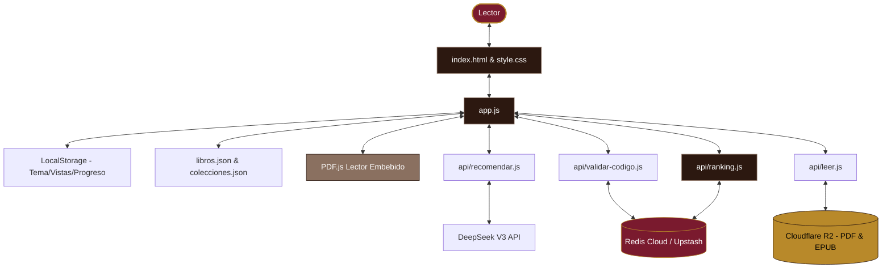

# ⚙️ Arquitectura: Vista General

Este documento describe la estructura arquitectónica general y las decisiones de diseño del sistema para **Libractiva**.

---

## 🎨 Diseño Conceptual

El proyecto está diseñado bajo una filosofía de **simplicidad técnica máxima en el cliente** y una **estética visual editorial premium**. Utiliza tecnologías puras de la web (Vanilla stack) para garantizar rapidez, mantenibilidad y nulas dependencias pesadas.

---

## 📦 Stack Tecnológico

### 1. Frontend (Cliente)
*   **HTML5 Semántico:** Estructura modular e interfaces accesibles (modales, buscador, filtros, paginación, visor PDF).
*   **Vanilla CSS3 (Variables Custom):** Estilos basados en un sistema de diseño estricto (vino `#7a1a2e`, dorado `#b8892a`, crema `#fcfbf7`). Soporta transiciones suaves de color y un modo oscuro completo mediante `data-theme="dark"`. Tipografías: **Cormorant Garamond** (marca), **Playfair Display** (títulos), **DM Sans** (interfaz/lectura) y **EB Garamond** (citas).
*   **Vanilla JavaScript (ES6+):** Lógica del lado del cliente sin dependencias pesadas:
    *   Carga y procesa `libros.json` (3,005 libros) y `colecciones.json` (15 packs temáticos y 58 sagas agrupadas dinámicamente).
    *   Motor de búsqueda híbrido en memoria: coincidencia exacta por título, autor y género + búsqueda difusa tolerante a errores tipográficos (*fuzzy search* vía distancia de Levenshtein con umbral calibrado).
    *   Navegación mediante rutas de hash (`#/libro/{id}`).
    *   Sección "Los más destacados" estable con orden fijo predeterminado (`LIBROS_DESTACADOS_IDS`), asignación de podio (oro, plata, bronce) y enriquecimiento asíncrono con métricas de lecturas desde Redis.
*   **PDF.js (Mozilla):** Lector de PDF embebido renderizado sobre `<canvas>`, con soporte para vista previa de 15 páginas, zoom, paginación táctil y guardado de progreso.
*   **Lucide Icons:** Iconografía SVG vectorial sobria y estandarizada en toda la interfaz (filtros, botones, controles, pestañas y modales) eliminando el uso de emojis informales.
*   **PWA (Progressive Web App):** Service Worker (`sw.js`) y `manifest.json` para instalación en escritorio y móviles.

### 2. Backend (Servicios Serverless en Vercel)
*   **`api/recomendar.js`**: Procesa la encuesta interactiva del lector y consulta la API de DeepSeek V3 (`deepseek-chat`).
*   **`api/leer.js`**: Genera URLs firmadas seguras de Cloudflare R2 con expiración corta (3 a 10 min) para lectura online y descargas de PDF o EPUB. Incrementa el contador global de lecturas en Redis.
*   **`api/validar-codigo.js`**: Valida códigos de acceso (LTD), calcula fingerprint de dispositivo y administra los cupos en Redis.
*   **`api/ranking.js`**: Endpoint serverless que expone los libros más leídos consultando el Sorted Set `ranking:lecturas` en Redis.
*   **Node.js 24.x:** Entorno de ejecución serverless en Vercel.

### 3. Almacenamiento y Bases de Datos
*   **Cloudflare R2 Object Storage:** Bucket `biblioteca-digital` con más de 30 GB que almacena el catálogo completo en formato dual (PDF y EPUB), sin costes de ancho de banda por salida (*zero egress fees*).
*   **Redis Cloud / Upstash:** Base de datos en memoria para validación instantánea de códigos LTD y control del ranking de lecturas.

### 4. Inteligencia Artificial
*   **DeepSeek V3:** Modelo de lenguaje utilizado por el recomendador inteligente para análisis literario y sugerencias contextualizadas en tiempo real.

---

## 💡 Decisiones de Diseño Clave

### 1. Carga Completa del Catálogo en el Cliente
*   **Decisión:** El catálogo de 3,005 libros está almacenado en un solo JSON estático (`libros.json`). La aplicación lo descarga por completo al iniciar la web y realiza las búsquedas directamente en memoria en la computadora del usuario.
*   **Pros:** Búsquedas instantáneas en <50ms (incluso con fuzzy search Levenshtein), nulo costo de base de datos para lectura de catálogo, arquitectura ultra simple.
*   **Contras:** La carga inicial requiere descargar ~2.1 MB (~450 KB con compresión gzip en Vercel y cache HTTP `max-age=86400`), optimizado para navegación veloz tras la primera visita.

### 2. Modo Oscuro Nativo
*   El tema se controla agregando el atributo `data-theme="dark"` al elemento raíz `<html>`. Las variables CSS cambian dinámicamente y el estado se almacena en el `localStorage` del cliente bajo la clave `tema` para persistir la preferencia en siguientes visitas.

### 3. Rutas Hash (`#/libro/{id}`)
*   Para evitar redireccionamientos y no perder la velocidad de una Single Page Application (SPA), la apertura de los detalles del libro se realiza con un modal que actualiza el hash de la URL. Esto permite a los usuarios compartir enlaces directos a obras específicas de la colección.

### 4. Persistencia de Progreso de Lectura
*   Para usuarios con acceso activo (donadores), el lector embebido guarda en `localStorage` la última página leída bajo la clave `libractiva_progreso`. Al abrir de nuevo un libro en curso, la SPA presenta un diálogo confirmatorio para decidir si reanudar en dicha página o iniciar desde el principio.

---

## 🔍 SEO e Indexación
Para asegurar que los motores de búsqueda indexen correctamente el sitio:
*   **JSON-LD SEO Dinámico:** El script `app.js` inyecta etiquetas de metadatos `schema.org` estructuradas en el `<head>` dependiendo de la página o libro activo.
*   **Sitemap y Robots:** Archivos estáticos en la raíz que guían a los buscadores a indexar la página principal bloqueando los scripts internos del backend.

---
**Notas Relacionadas:**
*   [[Arquitectura - Estructura del Proyecto|Estructura de archivos y carpetas]]
*   [[Arquitectura - API de Recomendación|Lógica del recomendador inteligente]]
*   [[Arquitectura - Estructura de Datos|Diseño de libros.json]]
*   [[Arquitectura - Auditoría y Rendimiento|Auditoría y Rendimiento]]
